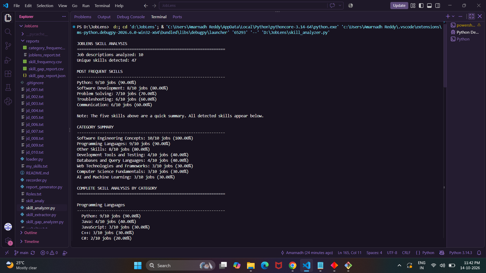
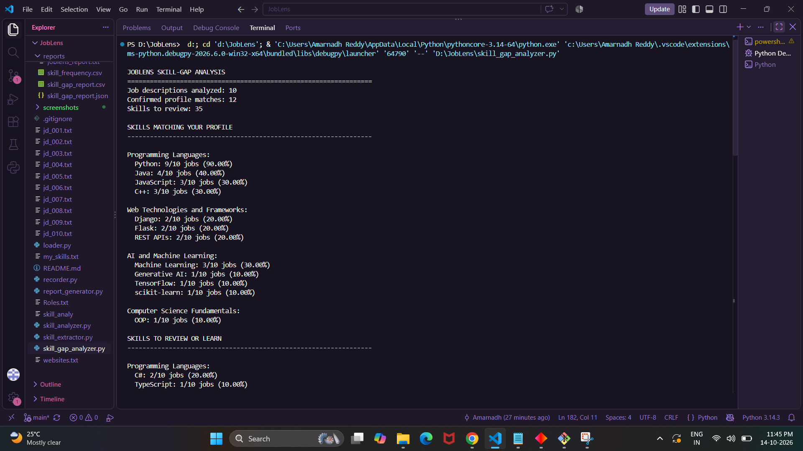

# JobLens — Job Market Skill Analyzer

**JobLens** is a Python-based project that analyzes job descriptions to identify frequently requested technical skills and compare them with a user's existing skill profile. It helps highlight relevant skills, understand hiring patterns within a collected sample, and identify areas that may need further learning.

## Problem Statement

Job seekers often find it difficult to determine which technical skills to prioritize when preparing for entry-level software development roles. Job requirements can vary across employers and positions, making it challenging to compare market expectations with existing skills.

JobLens addresses this problem by extracting skills from collected job descriptions, calculating their frequency, grouping them into categories, and comparing the results against a user-maintained skills profile.

## Objectives

- Analyze a collection of job descriptions using Python.
- Extract technical and professional skills using a curated skill dictionary.
- Calculate how frequently each skill appears across job descriptions.
- Categorize skills into meaningful groups.
- Compare detected skills against a user's self-reported profile.
- Generate CSV, JSON, and text reports for further analysis.
- Validate the collected job-description data before analysis.

## Features

- **Job description loading:** Reads locally stored job descriptions from text files.
- **Data validation:** Checks the collected dataset for supported structural issues.
- **Skill extraction:** Identifies known skills using keyword matching and regular expressions.
- **Skill frequency analysis:** Counts how many job descriptions mention each detected skill.
- **Category analysis:** Groups skills into categories such as programming languages, databases, web technologies, AI and machine learning, testing, and software engineering concepts.
- **Personal skill-gap analysis:** Compares extracted skills against the skills listed in `my_skills.txt`.
- **Report generation:** Exports analysis results into CSV, JSON, and plain-text formats.

## Technologies Used

- Python
- Regular expressions (`re`)
- File handling and text processing
- `collections.Counter` for frequency analysis
- CSV and JSON for structured reports
- Git and GitHub for version control

## Project Structure

```text
JobLens/
├── jd_001.txt
├── jd_002.txt
├── ...
├── jd_010.txt
├── Roles.txt
├── websites.txt
├── my_skills.txt
├── loader.py
├── recorder.py
├── skill_extractor.py
├── skill_analyzer.py
├── skill_gap_analyzer.py
├── report_generator.py
├── reports/
│   ├── skill_frequency.csv
│   ├── category_frequency.csv
│   ├── skill_gap_report.csv
│   ├── skill_gap_report.json
│   └── joblens_report.txt
└── README.md
```

### Main Components

| File | Purpose |
|---|---|
| `loader.py` | Loads the locally stored job descriptions. |
| `recorder.py` | Validates the collected job-description data and reports detected issues. |
| `skill_extractor.py` | Extracts recognized skills using a curated dictionary and regular expressions. |
| `skill_analyzer.py` | Calculates skill frequencies and summarizes results by category. |
| `skill_gap_analyzer.py` | Compares job-market skills with the user's profile. |
| `report_generator.py` | Generates the CSV, JSON, and text reports. |
| `my_skills.txt` | Stores the user's self-assessed skills. |
| `websites.txt` | Records the job-source websites used for the project. |
| `Roles.txt` | Records the roles considered during data collection. |
| `data/jds/jd_*.txt` | Stores the collected job descriptions. |

## How It Works

1. **Data collection:** Job descriptions for selected entry-level and related technical roles are stored as text files.
2. **Data loading:** `loader.py` reads the job-description files.
3. **Validation:** `recorder.py` checks the collected data for supported validation issues.
4. **Skill extraction:** `skill_extractor.py` searches the text for known skills using keyword aliases and case-insensitive regular expressions.
5. **Frequency analysis:** `skill_analyzer.py` counts each detected skill at most once per job description and calculates its frequency.
6. **Skill-gap analysis:** `skill_gap_analyzer.py` compares the detected skills with the user's self-reported skills.
7. **Report generation:** `report_generator.py` creates reports that can be reviewed or used for further analysis.

## Getting Started

### Prerequisites

- Python 3 installed
- Git (optional, for cloning the repository)
- A terminal such as PowerShell or the VS Code terminal

### 1. Clone the Repository

```bash
git clone https://github.com/AmarnadhReddy2003/JobLens.git
cd JobLens
```

Alternatively, download the repository and open the project folder in VS Code.

### 2. Run Data Validation

```bash
python recorder.py
```

Review the output for any reported validation issues before proceeding.

### 3. Analyze Skill Frequencies

```bash
python skill_analyzer.py
```

This displays the number of job descriptions analyzed, the most frequently detected skills, category-level summaries, and the complete skill analysis.

### 4. Analyze Your Skill Gaps

```bash
python skill_gap_analyzer.py
```

This compares detected skills with the profile in `my_skills.txt` and groups the results into confirmed profile matches and skills to review or learn.

### 5. Generate Reports

```bash
python report_generator.py
```

The generated reports are saved in the `reports/` directory.

> Run the commands from the project root directory. If `python` is not recognized on your system, try `py` instead.

## Output Reports

| Report | Description |
|---|---|
| `skill_frequency.csv` | Skill-level frequency results across the collected job descriptions. |
| `category_frequency.csv` | Frequency results grouped by skill category. |
| `skill_gap_report.csv` | Tabular comparison of detected skills with the user's profile. |
| `skill_gap_report.json` | Structured JSON version of the skill-gap results. |
| `joblens_report.txt` | Readable summary of the analysis. |

## Sample Results

For the current dataset of 10 job descriptions, the analyzer reports:

| Skill | Job descriptions mentioning it | Frequency |
|---|---:|---:|
| Python | 9 out of 10 | 90% |
| Software Development | 8 out of 10 | 80% |
| Problem Solving | 7 out of 10 | 70% |
| Troubleshooting | 6 out of 10 | 60% |
| Communication | 6 out of 10 | 60% |

The current skill-gap analysis identifies 12 detected skills as matches for the supplied profile and places 35 other detected skills in the review-or-learn category.

These figures describe the current dataset and profile only. They are not universal estimates of employer demand or a definitive assessment of the user's abilities.


## Project Screenshots

### Skill Frequency Analysis

This output shows the most frequently detected skills, category-level summaries, and complete skill frequency results across the collected job descriptions.



### Personal Skill-Gap Analysis

This output compares detected job-market skills against the user's self-reported skills profile and identifies skills to review or learn.




## Limitations

- The analysis is based on a sample of 10 collected job descriptions.
- The sample may not represent all employers, industries, locations, or entry-level technical roles.
- Skill extraction relies on a curated dictionary and keyword matching. Skills expressed using unrecognized terms or different wording may be missed.
- Keyword matching does not fully understand context. A detected skill mention does not necessarily mean that an employer treats the skill as mandatory.
- A skill listed for review is not confirmed in the supplied profile; this does not prove that the user lacks that skill.
- Skill frequency alone does not determine the importance of a skill for a particular job.
- The project analyzes locally stored descriptions and does not automatically collect live job postings.

## Future Improvements

- Expand the dataset with more job descriptions from varied employers and roles.
- Improve skill extraction to recognize additional aliases and contextual variations.
- Separate technical skills, tools, and general professional competencies more clearly.
- Add visualizations for skill frequencies and category comparisons.
- Introduce role-specific comparisons and configurable skill profiles.
- Evaluate extraction accuracy against manually reviewed job descriptions.

## Author

**Amaranadha Reddy Thallapureddy**

GitHub: [AmarnadhReddy2003](https://github.com/AmarnadhReddy2003)

Project repository: [JobLens](https://github.com/AmarnadhReddy2003/JobLens)
